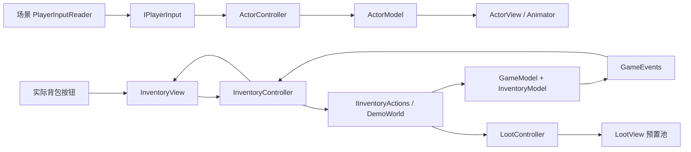

# BetterDesign / Sanctuary

Unity 2022.3.29f1。打开 `Assets/BetterDesign/Scenes/BetterDesignDemo.unity` 即可检查已配置的地图、玩家、敌人、管理器、对象池和完整 TMP UI。所有修改仅在 `Assets/BetterDesign/` 内，原资源只引用，不修改。代码通过 GitHub API 提交，本地项目未改动。

## 更新和运行

检出 `codex/better-design-sanctuary` 分支后 `git pull --ff-only`，等待 Unity 编译。打开上述场景，点击 Play，然后点击 Game 视图取得输入焦点。无需运行生成器，也无需更改 Build Settings。

场景里有 **576 个预置 GameObject**：玩家、16 个敌人槽位（首波 6 个启用）、48 个特效槽位、64 个掉落物槽位、地图、相机、EventSystem、输入与其他管理器、12 个背包格子。Play 时不创建 GameObject、组件或纹理，后续波次、投射物和掉落复用已有对象。

## 玩家输入在哪里

在 Hierarchy 中选择 **Managers → PlayerInput - Inspector Key Bindings**。其 `PlayerInputReader` 组件可直接修改移动、近战、法术、冲刺、交互、补给、背包、暂停、存读档的 KeyCode；方向键与鼠标按钮可单独关闭。GameManager 的 `inputReader` 已引用这个实际场景组件。

输入链路：`PlayerInputReader.Capture` 每帧采样一次 → `IPlayerInput` → `ActorController` → `ActorModel` → `ActorView.Render`。控制器不直接调用 Unity Input。暂停/背包/失焦时屏蔽玩法输入，鼠标位于 UI 上时不会触发鼠标战斗命令。默认使用原项目已启用的 Legacy Input，不依赖轴名配置，不修改 InputManager 或 Packages。

| 默认输入 | 行为 |
| --- | --- |
| WASD / 方向键 | 移动，斜向速度归一化 |
| Space / 左键 | 当前武器攻击：剑为扇区近战，弓可移动射击 |
| R / K | 切换剑与弓 / 消耗技能点升级法术 |
| Q / 右键 | 投射物法术 |
| Left Shift | 冲刺、短暂无敌、冷却 |
| E / B | 信标契约交互 / 花 10 金币购买补给 |
| H | 使用治疗补给，恢复 40 HP |
| Tab / Esc | 背包 / 暂停；支持面板栈返回 |
| F1 | 架构观察面板 |
| F5 / F9 | 存档 / 读档 |
| N | 清场后下一波 |

## MVC 是怎样落地的

| 模块 | Model | Controller | View |
| --- | --- | --- | --- |
| 角色 | Core/ActorModel：位置、生命、面向、FSM | ActorController：输入、AI、攻击前摇、命中、冲刺、硬直 | ActorView：只将模型映射到 Transform / SpriteRenderer / Animator |
| 背包 | Core/InventoryModel：12 格、堆叠、容量、原子增删 | Core/InventoryController：选择/使用/丢弃/出售命令，订阅模型事件 | InventoryView：实际场景中的图标、数量、格子与说明 |
| 游戏进度 | GameModel：金币、任务、波次、共享 Player 模型 | DemoWorld：协调战斗、波次、掉落、存档 | DemoHud：UGUI/TMP HUD 与模态面板 |
| 掉落 | LootSnapshot：物品、数量、地面坐标 | LootController：容量预留、拾取、快照与回收 | LootView：预置 SpriteRenderer、物品图标与浮动反馈 |

**角色 Transform 不再是玩法位置的真值，ActorController 不再单独保存 HP。** 玩家控制器直接共享 `GameModel.Player`，治疗与受伤修改同一份 ActorModel，避免模型、控制器、UI 生命不同步。Core 程序集禁止引用 UnityEngine，InventoryController 只依赖 `IInventoryView` / `IInventoryActions`。

调用方向：输入/按钮 → Controller → Model → 类型化模型事件 → Controller/Presenter → View。角色 View 不处理按键或写入背包，InventoryView 不直接增删物品，模型不访问 TMP、Transform 或 GameObject。

## 掉落和背包闭环

敌人死亡只记录击杀，不直接增加金币。每个敌人留下 **5 金币 + 1 个物品**：每第 3 名敌人掉治疗补给，其余掉蘑菇材料。沿用仓库金币、肉食和蘑菇图标；肉食图标代表治疗补给，没有新增不存在的药水美术。

靠近到 0.8 单位内自动拾取；新掉落至少显示 0.5 秒后才可拾取。金币进入钱包；补给与材料进入背包。背包满时整个掉落保留在地面，不进行部分入账。物品不会自动过期。

按 Tab 打开实际的 **4×3 背包格子**。每格有图标、名称、堆叠数量和选中高亮；右侧显示描述与容量。可选择：
- **使用选中物品**：仅治疗补给可用，满血或死亡不消耗。
- **丢弃 1 个**：背包扣除一个，在角色前方生成池化地面物品，可重新拾取。
- **出售所有蘑菇**：每个 2 金币，为后续拾取腾出空间。
- **返回游戏**：关闭背包，恢复模拟。

补给每格最多 10，蘑菇每格最多 20；先补齐已有堆叠，再使用空格。增加与拾取是整批原子操作。购买和契约奖励在空间不足时不会扣款或标记已领取。

掉落池共 64 槽。进入下一波前预留该波所有敌人的掉落容量；玩家丢弃也不能占用仍活着的敌人所需的预留空间。这样既不动态扩容，也不会因为地面残留物品而吞掉死亡奖励。

## 场景与 UI 配置

- `Managers`：GameManager、WorldManager、PersistenceManager、PlayerInput。
- `Actors`：玩家和 16 个已配置 SpriteRenderer / Animator / ActorView 的敌人。
- `Pool`：48 个预置特效；`Loot`：64 个预置拾取对象。
- `Map`：可编辑的地面、道路、院落、边界和信标。
- `UI - Canvas / UIManager`：HUD、任务、观察面板、模态遮罩、背包和暂停面板。
- 背包面板上挂 `InventoryView`，12 组名字/数量/图标/背景均已绑定；按钮 OnClick 也已序列化，包括各格的整数索引。

**49 个 TextMeshProUGUI 全部直接引用 `Assets/Fonts/7000msyhbdallicon SDF.asset`**（GUID `563ebed8c882c5e458174c07361ae986`），不改 TMP 全局配置和原字体文件。场景有 22 个按钮，不使用运行时 AddListener。默认隐藏的背包/暂停面板可以在编辑模式临时启用，调整布局后恢复隐藏。

## 动画、对象池与性能

Hero/Enemy Controller 使用 Speed 1D Blend Tree（Idle/Run）、参数阻尼与固定时间 CrossFade。攻击片段保留在 BetterDesign 内，移除了旧项目动画事件，伤害由 FSM 时钟触发一次。Sprite 帧仍是离散图像，不宣称骨骼式连续形变。

战斗和拾取遍历固定数组；对象池登记预置组件；特效可用容量从预热值倍增至场景储备硬上限，耗尽不创建 GameObject。Core 事件订阅由场景生命周期释放，无静态事件/全局单例。暂停冻结本世界与 Animator，不改变全局 Time.timeScale。UI 文本、拾取提示和快照允许分配，**不宣称全局零 GC**。F1 观察面板每 0.25 秒更新；Profiler 中 `BetterDesign.World` 覆盖世界模拟。

## 存档与迁移

存档保留原路径 `Application.persistentDataPath/better-design-v1.json`，当前载荷版本为 **3**，以便沿用原备份和读取 v1/v2 存档。v1 药水计数迁移为治疗补给堆叠；旧存档中已经直接结算的金币保持原值。

v3 额外保存场景身份、等级/经验/技能点、武器、法术阶数、任务接取基线和世界事实；v1/v2 迁移时使用默认成长数据。v2 开始保存玩家模型、金币/任务/波次、**完整 12 格背包、存活敌人以及尚未拾取的地面物品**。已经拾取的掉落从地面快照中移除，读档不会再次授予；读档恢复的是当时的背包与地面，不累计到当前状态。攻击进度、无敌时间与投射物不保存。校验失败时保留当前世界；JSON 校验和、临时文件 flush、原子替换与备份恢复沿用现有实现。死人不能覆盖检查点，New run 不删除原存档。

## 验证入口与状态

已做场景文本、fileID/父子关系、输入/管理器字段、49 个字体引用、12 个格子索引及 22 个按钮目标方法检查。已使用 Unity 2022.3.29f1 在独立临时项目中执行编译与自动测试；未改变当前工作副本。具体结果及验证边界见 [VALIDATION.md](VALIDATION.md)。架构审查、依赖、生命周期、取舍及迁移顺序见 [ARCHITECTURE.md](ARCHITECTURE.md)。

1. **Tools → BetterDesign → Validate Assets**：检查完整场景、输入组件、掉落池、背包、字体与按钮引用。
2. **Window → General → Test Runner → EditMode → BetterDesign.Tests → Run All**：42 个测试覆盖模型、MVC 命令路由/订阅解除、堆叠/满包原子性、奖励容量门禁、拾取前不结算、旧档迁移、掉落保存与池容量、FSM、事件、JSON 往返/损坏恢复。
3. 打开场景 Play，在 PlayerInput 组件中改一个按键，验证移动/近战/法术/冲刺与暂停门禁。
4. 击败一个敌人，确认地面出现金币和补给/蘑菇；未靠近时金币不变，靠近后金币/格子更新。
5. Tab 选择物品、使用、丢弃并再次拾取、出售材料；满血使用不扣数量。
6. F5 保存含地面掉落的状态，拾取/消费后 F9，确认恢复原背包、钱包和地面物品，未重复累计。
7. 清场回信标领取奖励两次，确认只发一次；N 继续，验证对象池复用。
8. 重复暂停/背包与进出 Play，检查 Console、监听数量及 Profiler。

## 扩展边界

当前新增等级成长、剑弓切换、法术升级及持久化；仍未迁移原 RPG1 的全部内容。目前是二维平面、矩形边界与扇区/距离命中的架构 demo，不含障碍寻路、复杂物理碰撞、联网、触屏、拖拽交换格子、完整装备/技能树界面或制作系统。背包支持选中与按钮操作，未实现拖拽。扩展通过 IPlayerInput、IDamageable、IInventoryView、IInventoryActions 和 ISaveStore 接入。
