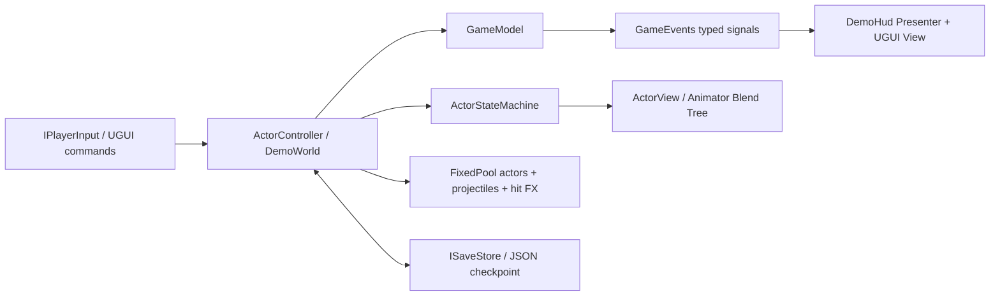

# BetterDesign / Sanctuary

Unity **2022.3.29f1** 的独立 2D 架构演示。所有新增资源均在 `Assets/BetterDesign/`；不修改旧场景、旧脚本、Packages、ProjectSettings 或 Build Settings。直接引用仓库已有的 Tiny Swords 角色、地面与动画资源。

## 运行

1. 检出本 PR 分支，使用原项目的 Unity 2022.3.29f1 打开。
2. 等待编译，打开 **Assets/BetterDesign/Scenes/BetterDesignDemo.unity**，点击 **Play**。
3. 或通过 **Tools → BetterDesign → Open Demo** 打开。
4. 场景采用显式代码装配：编辑模式中只有配置好的入口；进入 Play 后会生成场地、角色、预热池、相机、EventSystem 和 UGUI。无需执行生成器或修改 Build Settings。
5. 在 Game 视图中操作；建议 16:10 / 16:9，1280×800 或更高。F1 关闭右侧观察面板，可获得更多战场视野。
6. 单独打开本场景进行体验。旧项目的持久化 Manager 不属于本演示的生命周期。

## 体验闭环

向西侧青色信标移动，按 E 接取契约；击败 6 个守卫后回到信标按 E 领取 50 金币与 2 瓶药水。敌人死亡立即结算 5 金币，避免地面掉落物与存档之间的重复领取问题。在信标附近按 B，花费 10 金币购买药水。每波结束自动保存；按 N 开启下一波，数量最多 16，生命最多 500。失败时 F9 恢复检查点，或 ESC → New run 开始新局。

| 输入 | 行为 |
| --- | --- |
| WASD / 方向键 | 移动 |
| Space / 鼠标左键 | 近战（前方扇区范围，带前摇与冷却） |
| Q / 鼠标右键 | 池化投射物 |
| Left Shift | 冲刺，短暂无敌与冷却 |
| E / B | 信标任务交互 / 购买药水 |
| H | 使用药水，恢复 40 HP |
| Tab / Esc | 背包 / 暂停（支持面板栈返回） |
| F1 | 架构观察面板 |
| F5 / F9 | 存档 / 读档 |
| N | 清场后下一波 |

## 架构导航

- **Core**（无 UnityEngine 引用）：`GameModel` 是游戏数据与规则；`Signal<T>` 是有生命周期的类型化事件；`FixedPool<T>` 是定容对象池；`ActorStateMachine` 维护显式状态与锁定规则。
- **Runtime/Gameplay**：`ActorController` 接收输入接口，管理攻击前摇、移动、冲刺、硬直、死亡和 AI；`DemoWorld` 装配角色、战斗、波次、存档快照与池化对象。
- **Runtime/Presentation**：`ActorView` 只负责 SpriteRenderer、Animator、朝向、排序和受击反馈。
- **Runtime/UI**：`DemoHud` 是 UGUI View + Presenter，按钮发送命令，模型事件驱动刷新；`PanelStack` 管理模态返回与暂停所有权。
- **Runtime/Infrastructure**：`ISaveStore` / `JsonSaveStore` 提供版本化 JSON、校验和、临时文件 flush、原子替换、备份恢复、失败时保留当前世界。
- **Runtime/Configuration**：`DemoSettings` ScriptableObject 控制数值和美术依赖，无需改动玩法代码。
- **DemoScene**：唯一入口，在 Awake 注入 `IPlayerInput` / `ISaveStore`，统一 Tick，退出时解除订阅和销毁生成资源。无全局单例、静态事件、跨场景残留。
- **Editor / Tests**：资源验证、Scene 视图提示与 EditMode 测试。程序集依赖为 Core ← Runtime ← Editor/Tests。

这是一份用于观察与扩展的游戏 demo：MVC 体现在模型、控制器、表现适配器分离；UI 使用 Presenter 将模型事件映射到 UGUI。刻意不引入自动扫描的服务定位器或第三方框架。

## 动画

`Animations/Hero.controller` 与 `Enemy.controller` 各有一个 `Speed` 1D Blend Tree（Idle / Run）。`ActorView` 使用缓存的参数哈希、0.12 秒参数阻尼和固定时间 CrossFade，切换到 Attack，再按玩法状态返回 Locomotion。方向使用 sprite flip，保持原素材的侧向画法。

攻击动画在 BetterDesign 内复制并移除了旧的 `PlayerDamageDeal` / `EndPlayerAttack` / `EnemyConbat` 回调，原资源保持原样。伤害由角色控制器的状态时钟触发一次，动画不是伤害真值来源。Sprite 动画的图像帧是离散的；Blend Tree 不会让两张精灵变成骨骼动画式的连续形变。

## 性能与 GC

- 16 个敌人 View 和 48 个投射物/受击 FX 在启动时预热，容量耗尽会记录 Misses，拒绝生成，不在战斗热路径自动扩容。
- 战斗遍历固定数组，不使用 LINQ、每帧 Find、GetComponents、闭包、协程或 Instantiate/Destroy；死亡 View 归还池。
- 控制器在波次边界按需复用/创建；保存和切换波次是允许分配的边界操作。
- UI 是实际的 UGUI，模型变化时刷新；架构诊断每 0.25 秒更新。文本拼接、UGUI 内部重建和事件提示仍可能分配，**不宣称全项目 0 GC**。
- Unity Profiler 中 `BetterDesign.World` sample 覆盖世界模拟。Managed heap 是托管堆占用，不能代替 GC.Alloc 指标；请在关闭 F1 诊断后检查 CPU/Memory Profiler。
- 暂停冻结本世界的模拟与角色 Animator，使用独立时间推进，不修改全局 Time.timeScale。

## 存档语义

存档位置为 `Application.persistentDataPath/better-design-v1.json`，备份为 `.bak`。与旧 SaveManager 隔离，不在 Assets 内写存档。SHA-256 用于检测损坏，不是反作弊加密。

保存玩家位置、HP、金币、药水、击杀统计、任务标记、波次及存活敌人的位置与 HP。读档前验证版本、数值、坐标和容量，成功后一次性重建当前波次。瞬态攻击进度、无敌时间和投射物在读档时取消，防止重复伤害。死人不能覆盖检查点；New run 不删除历史存档，下一次保存才会替换它。本演示面向桌面编辑器/Standalone 文件系统；WebGL 的存储后端需要另行实现 ISaveStore。

## 验证入口与当前验证状态

本次通过 GitHub API 创建文件，未修改本地项目。完成了文本结构、程序集引用、Unity GUID/fileID 引用和目录范围检查。**当前执行环境无法启动 Unity，未声称已通过编译、EditMode 测试或实际试玩。** 请按下面的验收顺序验证：

1. **Tools → BetterDesign → Validate Assets**：检查配置、场景入口、精灵引用、控制器 Blend Tree、攻击片段和旧回调隔离。
2. **Window → General → Test Runner → EditMode → BetterDesign.Tests → Run All**：14 个测试覆盖事件订阅重入/解除、异常清理、池耗尽/重复归还/外来对象、状态锁与死亡、任务奖励幂等、补给与商店、无效快照、波次门禁、JSON 往返与损坏备份恢复。
3. 打开场景 Play：无 Missing Script、无旧动画回调错误；移动、近战、法术、冲刺与受击均可观察。
4. 完成任务、领两次奖励（第二次不增加金币）、购买/使用药水、清场后 N 进入下一波。
5. F5 保存，移动/战斗/消费后 F9，确认位置、敌方 HP、药水、金币恢复且投射物清空。
6. 先保存两次，退出 Play，在存档目录破坏主文件内容，重新 Play 按 F9，确认恢复上一份备份并显示提示。
7. 反复 Tab/Esc/返回，确认模态面板关闭后恢复模拟；重复进出 Play，确认无事件监听残留。
8. F1 查看状态机、事件与池计数；用 Profiler 检查热路径和容量上限。需要覆盖 Standalone 时，把此场景加入你自己的构建配置（本交付未修改全局 Build Settings）。

## 扩展边界

当前角色使用确定性二维平面移动、矩形场地边界与距离/扇区命中，适合观察架构，不含障碍寻路、复杂物理碰撞、联网、音频制作、触屏输入、Addressables、装备技能树或生产级本地化。拓展时通过 IPlayerInput / IDamageable / ISaveStore 与配置资产接入；地图、碰撞和寻路可以替换 DemoWorld 的场地与移动约束。
